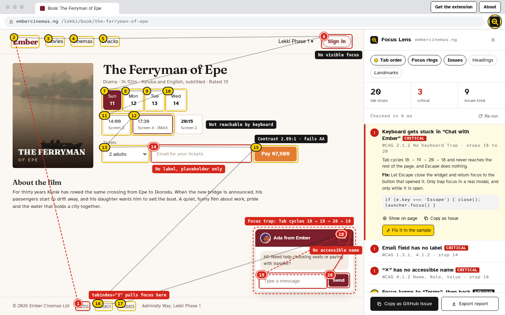
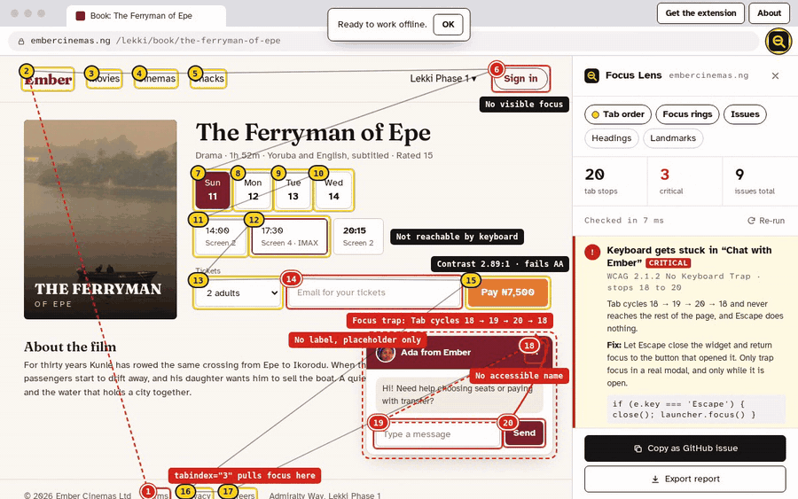
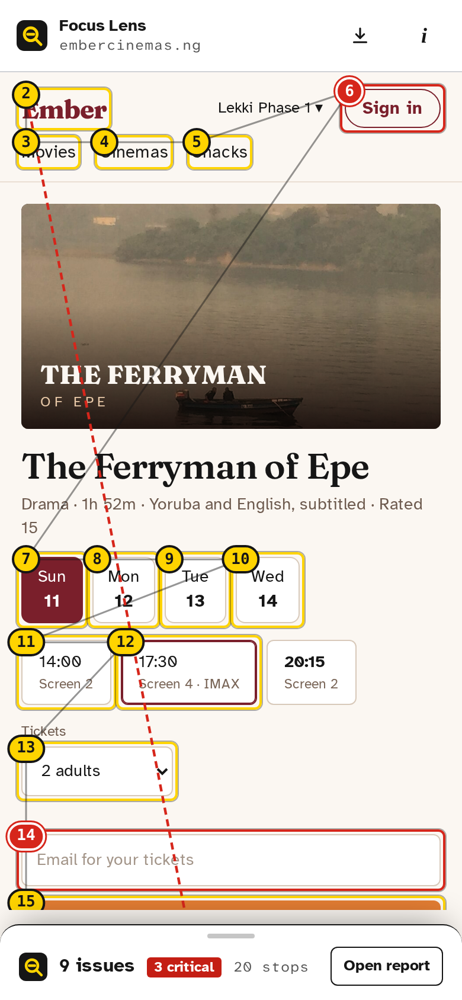
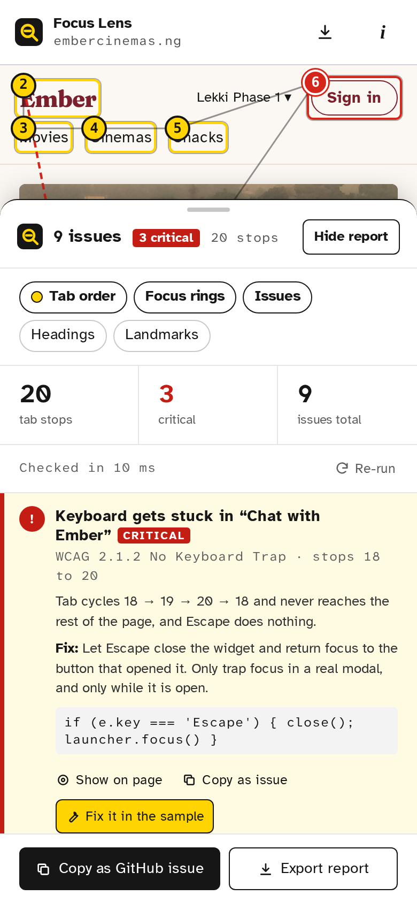
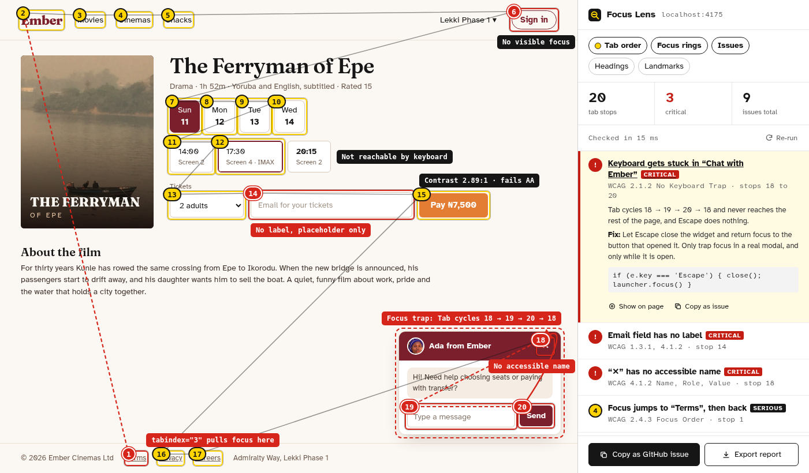

# Focus Lens

**See a page the way a keyboard does.** Focus Lens numbers every tab stop on a page, draws the path between them, and points at the places where keyboard and screen reader users get stuck: focus traps, controls with no name, text that fails contrast, focus rings that were styled away.

It ships two ways from one codebase:

- **A Chrome extension** (Manifest V3, side panel) that audits whatever tab you're on.
- **A live demo** you can open on any phone or laptop: a deliberately broken cinema booking page with the same panel beside it, where you can fix each flaw and watch the audit change. It installs as an app and works offline.

**Live demo: https://focus-lens-theta.vercel.app**





## What it finds

| Check                   | WCAG         | How                                                                                                                                                                                             |
| ----------------------- | ------------ | ----------------------------------------------------------------------------------------------------------------------------------------------------------------------------------------------- |
| Keyboard traps          | 2.1.2        | Focuses each stop, sends it a Tab keydown and follows wherever the page's own script moves focus. A walk that loops back without reaching the rest of the page is a trap. Then it tries Escape. |
| Missing names           | 4.1.2        | A focused subset of the [Accessible Name computation](https://www.w3.org/TR/accname-1.2/): `aria-labelledby`, `aria-label`, `<label>`, alt text, content, title.                                |
| Placeholder-only labels | 1.3.1, 4.1.2 | Reported separately, because Chrome _does_ fall back to the placeholder, so axe-style checks pass it.                                                                                           |
| Text contrast           | 1.4.3        | Composites translucent backgrounds and opacity up the tree, knows large text, skips text over images rather than guess, and suggests the nearest passing shade of the _same_ colour.            |
| Focus order             | 2.4.3        | Positive `tabindex`, shown on the tab path as the jump it causes.                                                                                                                               |
| Hidden focus            | 2.4.7        | Reads same-origin stylesheets for `:focus` rules that remove the outline and put nothing back.                                                                                                  |
| Unreachable controls    | 2.1.1        | Things that look clickable (`onclick`, a button role, a pointer cursor) but never take focus.                                                                                                   |
| Structure               | 1.3.1, 2.4.1 | Skipped heading levels and a missing `<main>`.                                                                                                                                                  |

Every issue comes with what goes wrong for a person, what to change, a code snippet where one helps, and a "Show on page" button. The whole report exports as **Markdown** or **JSON**, or copies as a ready-to-paste **GitHub issue** (one issue, or a checklist of all of them).

On the sample page, axe-core finds the contrast, tabindex, heading and landmark problems, but not the trap or the placeholder-only label. That gap is why this exists, and there's an end-to-end test that checks both tools against the same page.

## Try it

**In the demo:** open the live link. The audit runs as soon as the page loads. Toggle the overlay layers, open an issue, press **Fix it in the sample**, and the sample page is repaired and re-audited. Your fixes and layers are remembered; **Undo fixes** brings the flaws back. Tab into the chat widget with a real keyboard to feel the trap before you fix it.

**As an extension:**

1. Download `focus-lens-extension.zip` from the demo ("Get the extension"), or build it: `npm run build:ext` (output in `dist-ext/`).
2. Open `chrome://extensions`, turn on **Developer mode**, choose **Load unpacked** and pick the folder.
3. Open any page, click the Focus Lens icon, and press **Run audit** in the side panel.

`/sample.html` on the live site is the broken page on its own, if you want something to try it on.

| Phone                                                                                                                         | Phone, report open                                         | Extension side panel                                                              |
| ----------------------------------------------------------------------------------------------------------------------------- | ---------------------------------------------------------- | --------------------------------------------------------------------------------- |
|  |  |  |

## Stack

- **TypeScript, React 19, Vite 8.** No UI library: the components are small and the design is specific.
- **Chrome extension:** Manifest V3 built with [CRXJS](https://crxjs.dev): a side panel page, a two-line service worker, and a content script injected on demand.
- **PWA:** `vite-plugin-pwa` (Workbox) precaches the demo, the sample page, photos and fonts; an update prompt lets you choose when to reload.
- **Tests:** Vitest + Testing Library for the engine and the panel (45 tests), Playwright for end-to-end at 390px and 1440px with `@axe-core/playwright`, plus a project that loads the unpacked extension into Chromium and audits a real tab.
- **CI:** GitHub Actions runs lint, Prettier, typecheck, unit tests, both builds and the end-to-end suite.

## How it's put together

```
src/engine/    the audit: tab order, names, contrast, traps, rules. Plain DOM, no React.
src/overlay/   draws badges, paths and callouts in a shadow root over any document
src/report/    Markdown, JSON and GitHub issue exports
src/panel/     the report UI, shared by the demo and the extension
src/sample/    Ember Cinemas, the broken page, and the nine fixes it knows
src/demo/      the demo app: browser frame, phone sheet, dialogs, PWA bits
extension/     manifest, service worker, content script and side panel
```

The panel talks to an `AuditSource` with four methods: `run`, `setLayers`, `highlight`, `clear`. The demo's source audits the sample in an iframe; the extension's sends messages to a content script in the active tab. Everything above that line is the same code.

## Design decisions

- **The sample is a real page in a frame,** not a component in the demo. It has its own document, scroll, styles and focus, so the demo audits it exactly the way the extension audits a site. It also meant the engine had to work across realms, which flushed out `instanceof` checks that would have broken in some frames.
- **Traps are found by asking the page.** A content script can't press Tab, and static analysis can't see a `keydown` handler that wraps focus. Synthetic events can, because that is how traps are built. The audit restores focus and scroll when it's done.
- **Contrast fixes keep the brand.** The suggestion changes whichever colour is more saturated and only moves lightness, so an orange button gets a deeper orange (`#E37D33` → `#B85C19`, 4.58:1), not grey.
- **Ratios are rounded down.** 4.499:1 is a fail, so it reads 4.49:1, never "4.5".
- **Least privilege.** The extension asks for `activeTab`, `scripting`, `sidePanel` and `storage`. It can only read a page after you click it there, and nothing leaves the browser.
- **Calm on small screens.** On a phone the overlay shows callouts only for the issue you're looking at, and "Show on page" moves the sheet out of the way.
- **Its own look.** Black, white and safety yellow, set in Atkinson Hyperlegible, a typeface designed by the Braille Institute for legibility. The sample site has a deliberately different identity so it never blurs into the tool.

## Accessibility of Focus Lens itself

- The demo shell and panel pass axe with no violations at both sizes (checked in CI); only the sample page is broken, on purpose.
- Every control is a real button or link with a visible focus style (a black ring with a yellow halo, readable on any background).
- Layer toggles are `aria-pressed` buttons; issues are disclosure buttons with `aria-expanded`; the export menu closes on Escape.
- Dialogs are native `<dialog>` elements, so focus is contained and returned and Escape works without custom code.
- Results, fixes and copy confirmations are announced through polite live regions.
- The overlay is `aria-hidden` and never takes pointer events, so it can't get in the way of the page.
- `prefers-reduced-motion` stops the highlight pulse and makes "Show on page" jump rather than scroll smoothly.

## What it doesn't do

Automated checks find roughly a third of real accessibility problems. Focus Lens covers the keyboard part quickly and visually; it doesn't replace testing with a keyboard and a screen reader. It reads same-origin stylesheets only, doesn't look inside cross-origin iframes, and doesn't judge contrast over images or gradients.

## Develop

```bash
npm install
npm run dev          # the demo at http://localhost:5173
npm run build:ext    # the extension, in dist-ext/
npm test             # unit tests
npm run e2e          # end-to-end (builds first; run `npx playwright install chromium` once)
npm run build        # extension + zip + demo, as deployed
```

## Credits

Photos from Wikimedia Commons by Michal Klajban (CC BY-SA 3.0), Kaizenify (CC BY-SA 4.0) and Xeruz (CC BY-SA 4.0). Full details in [CREDITS.md](CREDITS.md).

## Licence

[MIT](LICENSE) © 2026 Emmanuel Balogun
